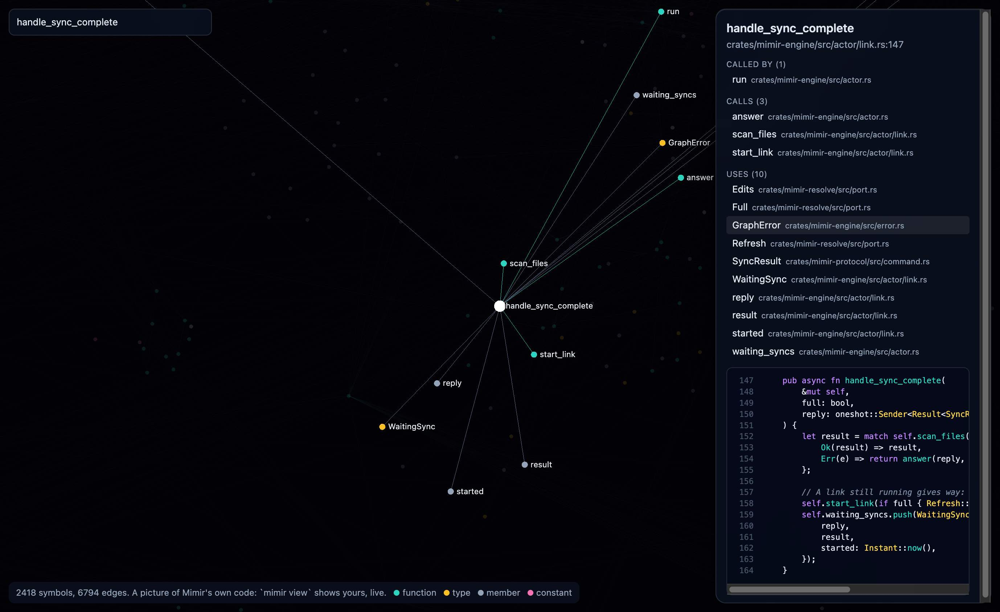

<p align="center">
  
</p>

<h1 align="center">Mimir</h1>

<p align="center"><strong>The call graph of your project for coding agents</strong></p>

<p align="center">
  <a href="https://github.com/julymetodiev/Mimir/actions/workflows/ci.yml"></a>
  <a href="https://github.com/julymetodiev/Mimir/releases/latest"></a>
  <a href="LICENSE"></a>
</p>

Who calls a function, what it calls, who uses a type or a field, and edits by symbol. `x.get()` links
to the `get` of `x`'s type, because the language's own compiler resolves it, where a text search finds every `get`.
It also has the tools an agent needs instead of Grep, Glob, Read, Edit and Write, so the graph stays up
to date as the agent works.

Rust, TypeScript, JavaScript and Python, on macOS and Linux. Go is in the works.

<p align="center">
  <a href="https://mimir.369.is/"></a>
  <br>
  <em>Mimir's own code: <a href="https://mimir.369.is/">Live</a></em>
</p>

<p align="center">
  <a href="https://mimir.369.is/"></a>
  <br>
  <em>A chosen symbol: what calls it, what it calls, what it uses, and its source.</em>
</p>

## Install

With [Homebrew](https://brew.sh), on macOS and Linux:

```bash
brew install julymetodiev/tap/mimir
```

Or download an archive for your platform from the
[latest release](https://github.com/julymetodiev/Mimir/releases/latest) and put `mimir` on your `PATH`.
The binaries are not signed, so on macOS one downloaded in a browser may need
`xattr -d com.apple.quarantine mimir`.

Or build it, with Rust 1.95 or newer:

```bash
cargo install --git https://github.com/julymetodiev/Mimir mimir-cli
```

For exact answers, Mimir needs `rust-analyzer` for Rust, [`tsrs`](https://github.com/oxc-project/tsrs) for TypeScript and JavaScript, and [`ty`](https://github.com/astral-sh/ty) for Python. In a Python project, install its packages in a `.venv` at the top: without them less is answered.

```bash
rustup component add rust-analyzer rust-src
npm install -g tsrs
pipx install ty
```

## Use it

In a git repository, nothing else is needed. The first command starts a daemon, which stops after 30
idle minutes or when the project is gone.

```bash
mimir trace -s process_data              # who calls it, what it calls
mimir trace -s process_data --callers    # only who calls it
mimir search --pattern "^process"        # symbols by regular expression
mimir grep "TODO" --path "*.rs"          # text in any file, with the symbol it is in
mimir read -s process_data               # the source of a symbol
mimir files "crates/**/*.rs"             # files by glob, skipping what git ignores
mimir cat src/lib.rs --first 10 --last 40  # a file, numbered
mimir write src/new.rs --content "fn new() {}"  # a new file; --overwrite to replace one
mimir edit --symbol process_data --mode symbol --content "fn process_data() {}"
mimir edit --file src/lib.rs --mode text --old "a = 1" --content "a = 2"  # exact text, found once
mimir sync                               # up to date, wait until nothing is provisional
```

## Connect your agent

Through MCP, the same operations are tools the model can use: `trace`, `search`, `read`,
`edit_symbols`, `insert_after`, `grep`, `files`, `read_file`, `edit_lines`, `replace_text`,
`write_file`, `sync`, `status`. The server is `mimir mcp`, and it serves the git repository of the
directory it runs in. So for most agents, add it to the project's own settings. `mimir` must be on the
`PATH` the agent sees.

### Claude Code

The plugin brings the server and a skill that tells the model when to use it instead of Grep, Glob,
Read, Edit and Write:

```
/plugin marketplace add julymetodiev/Mimir
/plugin install mimir@mimir
```

Or only the server, without the skill:

```bash
claude mcp add --scope user mimir -- mimir mcp
```

### Other agents

There is no plugin for these yet: add the server to the file shown. Claude Code is the one agent
Mimir has been used with so far, so these come from each agent's configuration format and are untested.
If one does not work, please [open an issue](https://github.com/julymetodiev/Mimir/issues).

| Agent | File in the project |
|---|---|
| Cursor | `.cursor/mcp.json` |
| Gemini CLI | `.gemini/settings.json` |
| Roo Code | `.roo/mcp.json` |

```json
{ "mcpServers": { "mimir": { "command": "mimir", "args": ["mcp"] } } }
```

Codex, in `.codex/config.toml`:

```toml
[mcp_servers.mimir]
command = "mimir"
args = ["mcp"]
```

VS Code, in `.vscode/mcp.json`:

```json
{ "servers": { "mimir": { "type": "stdio", "command": "mimir", "args": ["mcp"] } } }
```

Zed, in `.zed/settings.json`:

```json
{ "context_servers": { "mimir": { "command": "mimir", "args": ["mcp"] } } }
```

OpenCode, in `opencode.json`:

```json
{ "mcp": { "mimir": { "type": "local", "command": ["mimir", "mcp"], "enabled": true } } }
```

Any other MCP client: run `mimir mcp` over stdio in the project's directory. To teach an agent when to
use the tools, put [the skill's text](integrations/claude-code/skills/mimir-code/SKILL.md) in its
instructions, such as `AGENTS.md`.

## See it

[Look at Mimir's own code this way](https://mimir.369.is/), in a browser with WebGPU. On
your project:

```bash
mimir view
```

A browser opens on the whole graph, which changes as the code and the agents do. Symbols are placed by
crate and file. Zoom in, search, or choose a symbol to see what it calls, who calls it and its source.
What a query or an edit touches lights up as it happens, blue for a read and red for an edit, so you can
watch an agent work. It only reads, loads nothing from the network, and listens on `127.0.0.1` with a
private token in the address. It needs a browser with WebGPU; it has been tried in Chrome.

`mimir view --export DIR` writes the same page as files for any static host, with the graph as it is and
the source of every symbol, so use it only on code that may be public.

## What an answer means

- A call in `trace` is exact. A call Mimir cannot be sure of is left out, never guessed.
- `[via trait, possible]` and `[implementation, possible]`: which implementation runs is decided at
  runtime.
- `[as value, possible]`: a function named without being called, as in `.map(helper)`, or a constant
  holding one. It may run later, or never.
- `[reads it]`: on a constant or static, a symbol that reads it.
- `Partial:` analysis is still running, so calls may be missing. Ask again shortly.

Without `rust-analyzer`, `tsrs` or `ty`, or with `MIMIR_NO_SCIP=1`, only syntax rules apply, and `mimir
sync` says how many files that covers. In Rust they find about half the calls. In the others they link only
functions of the same file or of an import in the project, and no methods.

## How fast

On a copy of a project with 1311 Rust files and 20 260 symbols, on a laptop:

| | |
|---|---|
| A query with nothing changed | 0.01 to 0.02 s |
| A first answer after an edit | about 1 s (0.8 to 1.1 s), marked partial until complete |
| A complete answer after the first edit | 8 to 12 s, then under 1 s |
| From no daemon to a first answer | 3.2 to 3.8 s, with the index already written |
| A first index | 1 to 2 minutes, at a peak of about 6 GB |
| Memory | daemon about 370 MB idle; `rust-analyzer` about 2.2 GB while in use, stopped after 10 idle minutes |

On TypeScript, JavaScript and Python projects, on the same laptop, with the server stopped after 10 idle
minutes too:

| | hono | nest | three.js | flask | requests | django |
|---|---|---|---|---|---|---|
| Symbols | 12 497 | 27 854 | 27 387 | 2 046 | 1 114 | 67 865 |
| A first `mimir sync` | 11 s | 48 s | 45 s | 2.1 s | 0.9 s | 46 s |
| A new daemon with nothing changed | 1.0 s | 2.9 s | 4.2 s | 0.1 s | 0.1 s | 12 s |
| Daemon after asking | 121 MB | 187 MB | 373 MB | 32 MB | 28 MB | 598 MB |
| The server while in use | 963 MB | 1.6 GB | 603 MB | 179 MB | 152 MB | 1.1 GB |

An edit of a file most of a project imports asks about those files again: about 30 s on nest and django,
with answers marked partial until then.

## Accuracy

On Mimir's own code, 1326 of 1326 calls between its functions match what `rust-analyzer` reports. The
measurement says 1325, and the one difference is the measurement's: SCIP gives two functions in
different test binaries one symbol. Every entry of a hand-written list of traps in
[crates/mimir-resolve-ra/tests/fixture/expected.rs](crates/mimir-resolve-ra/tests/fixture/expected.rs) holds too: same
names across types and crates, calls inside macros, trait methods. Scripts behind these numbers are in
[scripts/bench](scripts/bench/README.md).

Who uses what, against `rust-analyzer`'s find-references on the project above:

| | Compared | Both agree | Only Mimir | Only the server |
|---|---|---|---|---|
| Constants and statics | all 944 | 1814 | 46 | 13 |
| Types and traits | a sample of 40 | 420 | 0 | 0 |
| Variants | a sample of 40 | 295 | 0 | 0 |
| Fields | a sample of 40 | 157 | 0 | 0 |

"Only Mimir" is mostly code a server on this machine does not compile, as behind `#[cfg(...)]` or a
feature. A graph kept up to date through edits had 0 differences from a new index, on edits of comment
lines in 3 files. These are measurements of one project, not a guarantee for yours.

In TypeScript and JavaScript, against `scip-typescript`, the targets inside a project agree at 70 998 of 72 557 places on hono, 57 401 of 58 894 on nest and 91 559 of 108 715 on three.js. Nearly all the rest are places only `tsrs` answers, or the start of a file against its first line; `scripts/bench/scip_compare.py` names each kind. After edits of comments in 2 to 3 files the graph had 0 differences from a clean start, on hono and nest. Agreement is not proof: these two tools can be wrong together.

In Python, against `scip-python`, the targets inside a project agree at 99.4% of the places on flask, 99.3% on requests and 96.2% on django, which is 459 650 of 477 676. On django most of the rest are the start of a file against its first line, or the index naming another class, as `models.CharField` at `DateTimeField` where it was read. `ty` has no answer at 3 509 places where the index has one. Agreement is not proof: `scip-python` is built on `pyright`, another checker, and can be wrong.

Known limits in Python: what has no type has no target, about a fifth of the calls in django's own code, and Mimir leaves those out and does not guess. A call the source does not spell gives no edge, as `a + b` running `__add__`. A class that fits a `Protocol` without naming it is not shown as implementing it. A package installed without a change to a lock file leaves saved answers stale. After edits of 3 files on django the graph had 1 difference from a clean start, in 116 546 edges, because an answer of `ty` can depend on what it was asked before. Environments other than a `.venv` at the top of a project are not measured. `ty` is a young beta.

Known limits in TypeScript and JavaScript: what has no type has no target, so plain JavaScript gets about two thirds of its calls (62% on express, 66% on three.js, against 91% and 94% on TypeScript projects). Mimir leaves the rest out and does not guess. `list[0].area()` on a union of types shows one member. pnpm and yarn workspaces are not measured, and `.vue` and `.svelte` files are left out. `tsrs` is a young beta.

Known limits in Rust: a proc macro that fails silently while the index is written loses its calls;
one that says so is handled. A read and a write of a field are not told apart. A constant inside a format string has a read only in macros known to take one, and only if it is an item of the same module or imported by a project path: an attribute such as `#[error("{NAME}")]`, a glob import or a renamed import leaves it out. A function named in an attribute, as in `#[serde(skip_serializing_if = "name")]`, has no call. Replacing a file by renaming breaks a hard link to it.

Left out on purpose for now: telling a read of a field from a write; keeping hard links when a file is written.

## Develop

Read [docs/ARCHITECTURE.md](docs/ARCHITECTURE.md), the specification, and
[CONTRIBUTING.md](CONTRIBUTING.md). `scripts/check.sh` runs every check.

Security: [SECURITY.md](SECURITY.md). Changes: [CHANGELOG.md](CHANGELOG.md). Releases:
[RELEASING.md](RELEASING.md).

## License

[MIT](LICENSE)
